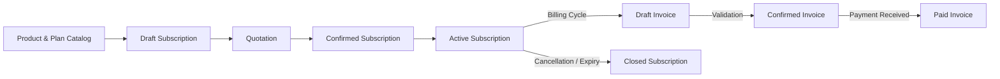

# RecurEngine ⚡

> Modern, scalable recurring billing, subscription lifecycle management, and financial analytics backend engine built with **NestJS** and **TypeScript**.

---

## 📖 Overview

**RecurEngine** is a modular backend service tailored for subscription-first businesses, SaaS platforms, and recurring service providers. It coordinates the entire customer billing journey—from catalog definition and quoting to subscription state transitions, invoice generation, discount calculation, payment reconciliation, and real-time revenue analytics (MRR/ARR).

---

## ✨ Key Features

- **🔐 Authentication & Role-Based Access Control (RBAC)**: Secure password hashing (`bcrypt`), credential validation, and role guards supporting `ADMIN`, `STAFF`, and `CUSTOMER` tiers.
- **📦 Product & Variant Catalog**: Manage products with base sales/cost pricing, configurable metadata, and custom variants with price adjustments.
- **📅 Flexible Plan Engine**: Define recurring plans across frequencies (`DAILY`, `WEEKLY`, `MONTHLY`, `YEARLY`), availability windows, quantity minimums, and renewal policies.
- **🔄 Strict Subscription State Machine**: Manage lifecycle transitions with built-in guard rails:
  $$\text{Draft} \longrightarrow \text{Quotation} \longrightarrow \text{Confirmed} \longrightarrow \text{Active} \longrightarrow \text{Closed}$$
- **🧾 Automated Invoicing & Payments**:
  - Auto-generate line-itemized invoices directly from active subscriptions.
  - Calculate subtotals, taxes, and applied discounts.
  - Track invoice statuses (`DRAFT` $\to$ `CONFIRMED` $\to$ `PAID`) with payment recording.
- **🏷️ Promotional Discounts Engine**:
  - Fixed or percentage-based discount rules.
  - Minimum purchase / quantity thresholds, start and expiry windows, usage quota tracking (`ACTIVE`, `EXPIRED`, `DEPLETED`).
- **📊 Financial Analytics & Reporting**:
  - Executive financial summary dashboard.
  - Monthly Recurring Revenue (MRR) and Annual Recurring Revenue (ARR).
  - Overdue invoice tracking with customer attribution.
  - Period-based revenue aggregation (Monthly, Quarterly, Yearly) and top customer insights.

---

## 🏗️ Architecture & Subscription Flow



---

## 🛠️ Tech Stack

- **Runtime**: [Node.js](https://nodejs.org/) (v18+ recommended)
- **Framework**: [NestJS](https://nestjs.com/) v12
- **Language**: [TypeScript](https://www.typescriptlang.org/) v7
- **Validation**: `class-validator` & `class-transformer`
- **Security**: `passport`, `@nestjs/jwt`, `bcrypt`
- **Execution & Build**: `tsx` (fast dev runner) & `tsc`
- **Schema & Modeling**: Prisma Schema & Typed Models

---

## 📂 Project Structure

```text
RecurEngine/
├── prisma/
│   ├── schema.prisma          # Database schema definitions and relational models
│   └── model-user.ts          # Prisma user model helpers
├── src/
│   ├── auth/                  # Authentication, JWT/Local strategies, guards, and DTOs
│   ├── users/                 # User management and profile services
│   ├── products/              # Product and variant management
│   ├── plans/                 # Subscription plans and billing cadence logic
│   ├── subscriptions/         # Subscription state machine and line item handling
│   ├── invoices/              # Invoice generation, lifecycle, and settlements
│   ├── payments/              # Payment processing module
│   ├── discounts/             # Promotion and coupon management
│   ├── finance/               # Financial aggregation, MRR/ARR, and reporting
│   ├── decorators/            # Role and custom metadata decorators
│   ├── prisma/model/          # Core TypeScript domain models and interfaces
│   ├── app.module.ts          # Root application module
│   └── main.ts                # Application entrypoint & HTTP server bootstrap
├── package.json               # Dependencies and scripts
├── tsconfig.json              # TypeScript configuration
└── README.md                  # Project documentation
```

---

## 🚀 Getting Started

### Prerequisites

- [Node.js](https://nodejs.org/) (v18.x or later)
- [npm](https://www.npmjs.com/) (v9.x or later)

### Installation

1. **Clone the repository**:
   ```bash
   git clone <repository-url>
   cd RecurEngine
   ```

2. **Install dependencies**:
   ```bash
   npm install
   ```

3. **Configure Environment Variables** (Optional):
   Create a `.env` file in the root directory:
   ```env
   PORT=3000
   NODE_ENV=development
   JWT_SECRET=your_super_secret_jwt_key
   ```

### Running the Application

- **Development mode (with watch/hot-reload)**:
  ```bash
  npm run start:dev
  ```

- **Standard start**:
  ```bash
  npm run start
  ```

- **Production build & start**:
  ```bash
  npm run build
  npm run start:prod
  ```

Once started, the API will be available at:
```text
http://localhost:3000
```

---

## 📡 API Reference

### 🔐 Authentication (`/auth`)

| Method | Endpoint | Access | Description |
|---|---|---|---|
| `POST` | `/auth/signup` | Public | Register a new user account |
| `POST` | `/auth/signin` | Public | Authenticate user credentials |

#### Example: Sign Up
```http
POST /auth/signup
Content-Type: application/json

{
  "name": "Jane Doe",
  "email": "jane@example.com",
  "password": "SecurePassword123!"
}
```

---

### 👤 Users (`/users`)

| Method | Endpoint | Access | Description |
|---|---|---|---|
| `POST` | `/users/register` | Public | Create user with explicit role assignment |
| `GET` | `/users/me` | Authenticated | Retrieve authenticated user profile |
| `GET` | `/users/:id` | `ADMIN` | Retrieve user by ID |

---

### 📦 Products & Variants (`/products`)

| Method | Endpoint | Access | Description |
|---|---|---|---|
| `POST` | `/products` | `ADMIN` | Create a new catalog product |
| `GET` | `/products` | Public | List all active products |
| `GET` | `/products/:id` | Public | Retrieve product details by ID |
| `POST` | `/products/:id/variants` | `ADMIN` | Add a pricing variant to a product |

#### Example: Create Product
```http
POST /products
Content-Type: application/json

{
  "name": "Cloud Storage Pro",
  "type": "STORAGE",
  "salesPrice": 29.99,
  "costPrice": 10.00,
  "notes": "1TB Cloud Storage tier"
}
```

#### Example: Add Variant
```http
POST /products/:id/variants
Content-Type: application/json

{
  "name": "Extra 500GB Addon",
  "priceAdjustment": 9.99
}
```

---

### 📅 Plans (`/plans`)

| Method | Endpoint | Access | Description |
|---|---|---|---|
| `POST` | `/plans` | `ADMIN` | Create a billing plan |
| `GET` | `/plans` | Public | List active billing plans |
| `GET` | `/plans/:id` | Public | Get plan details by ID |
| `PATCH` | `/plans/:id/status` | `ADMIN` | Activate or deactivate a plan |

#### Example: Create Plan
```http
POST /plans
Content-Type: application/json

{
  "name": "Annual Business Tier",
  "billingFrequency": "YEARLY",
  "minimumQuantity": 1,
  "closeAutomatically": true,
  "canBeManuallyClosed": true,
  "canBePaused": true,
  "canBeRenewed": true
}
```

---

### 🔄 Subscriptions (`/subscriptions`)

| Method | Endpoint | Access | Description |
|---|---|---|---|
| `POST` | `/subscriptions` | `ADMIN`, `STAFF` | Create a draft subscription for a customer |
| `POST` | `/subscriptions/:id/items` | `ADMIN`, `STAFF` | Add product line items to a subscription |
| `POST` | `/subscriptions/:id/transition` | `ADMIN`, `STAFF` | Advance subscription state machine |
| `GET` | `/subscriptions` | Public | List all subscriptions |

#### Valid Lifecycle Transitions
- `Draft` $\to$ `Quotation`
- `Quotation` $\to$ `Confirmed` or `Closed`
- `Confirmed` $\to$ `Active` or `Closed`
- `Active` $\to$ `Closed`

#### Example: Transition Status
```http
POST /subscriptions/:id/transition
Content-Type: application/json

{
  "status": "Quotation"
}
```

---

### 🧾 Invoices & Payments (`/invoices`)

| Method | Endpoint | Access | Description |
|---|---|---|---|
| `POST` | `/invoices/generate/:subscriptionId` | `ADMIN`, `STAFF` | Generate draft invoice from subscription |
| `POST` | `/invoices/:id/confirm` | `ADMIN`, `STAFF` | Confirm draft invoice for billing |
| `POST` | `/invoices/:id/pay` | `ADMIN`, `STAFF` | Record a payment towards an invoice |
| `GET` | `/invoices` | Public | List all invoices |

#### Example: Record Payment
```http
POST /invoices/:id/pay
Content-Type: application/json

{
  "amount": 29.99,
  "paymentMethod": "CREDIT_CARD",
  "note": "Payment received via Stripe"
}
```

---

### 🏷️ Discounts (`/discounts`)

| Method | Endpoint | Access | Description |
|---|---|---|---|
| `POST` | `/discounts` | `ADMIN` | Create a promo code or discount rule |
| `POST` | `/discounts/apply` | `ADMIN`, `STAFF` | Apply a discount code to an invoice/subscription |
| `POST` | `/discounts/reset/:id` | `ADMIN` | Reset usage counters for an active code |
| `GET` | `/discounts` | Public | List active discounts |

#### Example: Create Discount
```http
POST /discounts
Content-Type: application/json

{
  "code": "LAUNCH20",
  "type": "PERCENTAGE",
  "value": 20.00,
  "minPurchaseAmount": 50.00,
  "minQuantity": 1,
  "startDate": "2026-01-01T00:00:00.000Z",
  "endDate": "2026-12-31T23:59:59.000Z",
  "maxUsages": 500,
  "applicableTo": "global"
}
```

---

### 📊 Finance & Analytics (`/finance`)

| Method | Endpoint | Access | Description |
|---|---|---|---|
| `GET` | `/finance/summary` | `ADMIN`, `STAFF` | Executive overview of MRR, ARR, and cash flows |
| `GET` | `/finance/active-subscriptions` | `ADMIN`, `STAFF` | Active subscription counts and recurring revenue |
| `GET` | `/finance/collected-revenue` | `ADMIN`, `STAFF` | Total collected revenue within a date window |
| `GET` | `/finance/overdue-invoices` | `ADMIN`, `STAFF` | Unpaid confirmed invoices past due date |
| `GET` | `/finance/revenue-by-period` | `ADMIN`, `STAFF` | Aggregated revenue (`monthly`, `quarterly`, `yearly`) |
| `GET` | `/finance/top-customers` | `ADMIN`, `STAFF` | Top spending customer rankings |

---

## 🗄️ Data Model Overview

The domain model is defined in `prisma/schema.prisma` and mirrored in TypeScript interfaces:

- **User**: Authentication credentials, profile, and role (`ADMIN`, `STAFF`, `CUSTOMER`).
- **Product & Variant**: Base item specifications and pricing variations.
- **Plan**: Recurrence definitions, frequency rules, and lifecycle behavior.
- **Subscription**: Main agreement instance tying customer, plan, and line items.
- **LineItem**: Product quantities, unit prices, tax amounts, and applied discounts.
- **Invoice**: Financial record issued against subscriptions with due dates and balances.
- **Payment**: Transaction log linked to invoices with payment method and settlement timestamp.
- **Discount**: Promotional rules, quota enforcement, and validity date constraints.

---

## 📜 Available Scripts

| Command | Description |
|---|---|
| `npm run start` | Runs the server using `tsx` |
| `npm run start:dev` | Runs the server in watch mode with instant restart on changes |
| `npm run build` | Compiles TypeScript source to `./dist` using `tsc` |
| `npm run start:prod` | Runs compiled production server from `./dist/main.js` |

---

## 🛡️ License

This project is licensed under the [ISC License](LICENSE).

